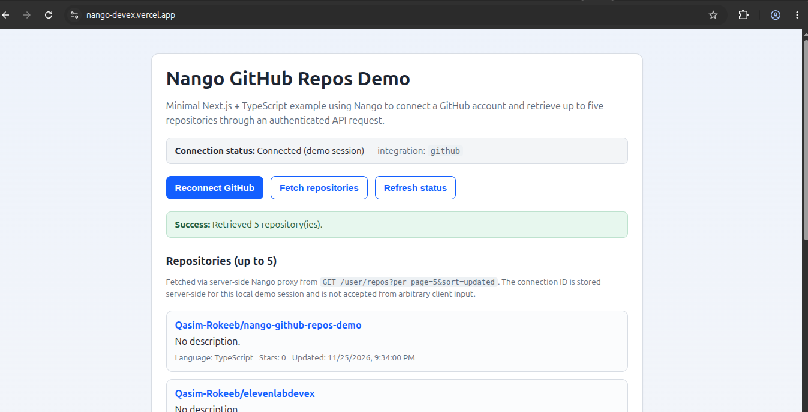

# Nango GitHub Repos Demo

This is a minimal Next.js + TypeScript example that shows how to use [Nango](https://nango.dev/) to connect a GitHub account and retrieve up to five repositories through an authenticated API request. It is for developers learning Nango’s Connect/auth flow and server-side proxy pattern in a simple web app. After setup, you can connect a GitHub account and fetch a small, recent repository list from the GitHub API.

> **Independent educational example** — this repository is not an official Nango or GitHub project.

## Preview

- Screenshot/recording: 
- Live demo: [https://nango-devex.vercel.app/](https://nango-devex.vercel.app/) (user-provided; deployment not independently verified in this session)

## What you’ll learn

- How to create a short-lived Nango Connect session on the server and open Connect UI on the client.
- How to capture a successful Nango connection event and store connection context for a demo session.
- How to make an authenticated GitHub API request through Nango’s proxy (`GET /user/repos`).
- How to keep Nango API keys server-only in a Next.js App Router app.
- How to document and handle a key demo limitation: connection ownership/auth checks.

## Features and scope

**Implemented**
- One-page UI with **Connect GitHub**, connection status, and **Fetch repositories** actions.
- Loading, success, and error states for status checks, connect flow, and repo fetch.
- Server endpoint to create a Nango Connect session token.
- Server endpoint to store/read/clear a demo connection for the current local session.
- Server endpoint to fetch up to 5 repositories from GitHub via Nango proxy.

**Not implemented / non-goals**
- Real user authentication, multi-user tenancy, or database-backed connection ownership.
- Webhook-based connection persistence (the demo uses the frontend Connect event).
- Deployment hardening, rate limiting, audit logging, AI features, or multiple integrations.

## Quickstart

### Prerequisites

- **Node.js**: a recent Node.js runtime (tested with Node 24.x in this environment; Next.js 14 requires a supported Node version).
- **Package manager**: npm (repository includes `package-lock.json`).
- **Nango account**: a Nango environment with an API key. The connect-session flow requires an API key with `environment:connect_sessions:write` scope per [Nango docs](https://nango.dev/docs/guides/auth/setup); a default/full-access dev key may also work if it has sufficient permissions.
- **GitHub integration in Nango**: a **GitHub (User OAuth)** integration configured in Nango. Nango offers a Nango-managed OAuth app option for GitHub in supported setups; you can also use your own OAuth app. See [Nango GitHub integration docs](https://nango.dev/docs/api-integrations/github).

### 1. Clone and install

```bash
git clone https://github.com/Qasim-Rokeeb/nango-github-repos-demo.git
cd nango-github-repos-demo
npm install
```

### 2. Configure the integration

1. In Nango, create or select a **GitHub (User OAuth)** integration and note its **Integration ID** (`providerConfigKey` / `unique_key`).
2. Get an environment API key from **Nango Environment Settings > API Keys**. Keep it server-only.
3. Create your local env file in the project root:

```bash
cp .env.example .env.local
```

4. Set the required values in `.env.local` (placeholders only):

```env
NANGO_API_KEY=<your-nango-environment-api-key>
NANGO_INTEGRATION_ID=<your-github-integration-id>
```

Notes:
- `NANGO_API_KEY` is a **secret server-side credential**. Do not expose it in client code or commit it.
- `NANGO_INTEGRATION_ID` should match your Nango GitHub integration ID (example: `github`).
- `NANGO_SECRET_KEY` is also accepted by the code as a fallback for older naming, but `NANGO_API_KEY` is the documented name in this repo.

### 3. Run locally

```bash
npm run dev
```

Open [http://localhost:3000](http://localhost:3000). If port 3000 is already in use, Next.js may start on a different port; use the URL printed in the terminal.

### 4. Confirm your first successful result

1. Start the app.
2. Click **Connect GitHub**.
3. Authorize the GitHub test connection.
4. Click **Fetch repositories**.
5. Confirm that up to five repositories appear.

If no repositories appear, check:
- The connection status in the UI
- Required environment variables (`NANGO_API_KEY`, `NANGO_INTEGRATION_ID`)
- Backend logs in the terminal running `npm run dev`
- Nango connection/logs in the Nango dashboard
- GitHub authorization permissions for the connected account

> A successful result is the repository list returned after connecting, not just the dev server starting.

## Configuration

| Variable | Required? | Purpose | Safe example |
|---|---:|---|---|
| `NANGO_API_KEY` | Yes | Server-only Nango environment API key used to create Connect sessions and make proxied API requests. | `nango_env_api_key_example` |
| `NANGO_SECRET_KEY` | No (fallback) | Legacy/fallback env name accepted by code; prefer `NANGO_API_KEY`. | `nango_env_api_key_example` |
| `NANGO_INTEGRATION_ID` | Yes | Nango integration unique key (`providerConfigKey`) for the GitHub User OAuth integration. | `github` |

- **Secret server-side credentials**: `NANGO_API_KEY` / `NANGO_SECRET_KEY`.
- **Public configuration**: none.
- **Optional settings**: `NANGO_SECRET_KEY` fallback only. No other app-level env vars are read by the implementation.

## What Nango handles

In this example, Nango handles:

- **OAuth authorization flow**: the frontend opens Nango Connect UI, and Nango manages the GitHub authorization flow for the configured integration.
- **Secure storage of connection credentials/tokens**: Nango stores the connection credentials; this app does not receive raw GitHub OAuth tokens in the browser.
- **Authenticated proxy request to GitHub**: the backend uses the Nango Node SDK to send `GET /user/repos` through Nango’s proxy using the stored connection.

The developer configures:

- The Nango integration (GitHub User OAuth, integration ID / `providerConfigKey`)
- GitHub authorization settings in Nango (Nango-managed OAuth app or your own OAuth app)
- Environment variables (`NANGO_API_KEY`, `NANGO_INTEGRATION_ID`)
- The backend request using the connection identifier (stored server-side in a demo session for this example)

## How it works

1. The user clicks **Connect GitHub**.
2. The frontend requests a short-lived session token from `POST /api/nango/session`; the backend creates it with the Nango Node SDK.
3. The frontend opens Nango Connect UI and sets the session token. GitHub asks the user to authorize access.
4. Nango completes the authorization and creates/stores the connection.
5. The frontend receives the `connect` event and sends the connection identifier to `POST /api/nango/connection`; the backend stores it in a local demo session (not a production ownership model).
6. When the user clicks **Fetch repositories**, the backend reads the stored connection and sends an authenticated proxy request to GitHub via Nango (`GET /user/repos?per_page=5&sort=updated&direction=desc`).
7. The UI validates and displays up to five repositories, or an empty/error state.

```text
User click → /api/nango/session → Nango Connect UI → GitHub authorization
         → Nango connection → /api/nango/connection (demo session store)
         → /api/github/repos → Nango proxy → GitHub /user/repos → UI
```

### Key code excerpt

Source: `app/api/github/repos/route.ts`

```ts
const res = await nango.get({
  endpoint: "/user/repos",
  providerConfigKey: connection.providerConfigKey,
  connectionId: connection.connectionId,
  params: {
    per_page: 5,
    sort: "updated",
    direction: "desc",
  },
});
```

## Project structure

```text
.
├── app/
│   ├── api/
│   │   ├── github/repos/route.ts      # Fetch up to 5 repos via Nango proxy
│   │   └── nango/
│   │       ├── connection/route.ts    # Demo connection status/store/clear
│   │       └── session/route.ts       # Create Nango Connect session token
│   ├── globals.css                    # Simple UI styles
│   ├── layout.tsx                     # App layout/metadata
│   └── page.tsx                       # One-page Connect + fetch UI
├── lib/
│   ├── demo-session.ts                # In-memory demo session/connection store
│   └── nango.ts                       # Server Nango client + env helpers
├── .env.example                       # Safe env var template
├── package.json                       # Scripts and dependencies
├── package-lock.json                  # npm lockfile
└── README.md
```

## Troubleshooting

| Symptom | Likely cause | How to check or resolve |
|---|---|---|
| `Missing NANGO_API_KEY server environment variable.` | `.env.local` missing or key not set | Copy `.env.example` to `.env.local`, set `NANGO_API_KEY`, restart `npm run dev`. |
| `Missing NANGO_INTEGRATION_ID server environment variable.` | Integration ID not configured | Set `NANGO_INTEGRATION_ID` in `.env.local` to your Nango integration `unique_key`. |
| `Could not create Nango connect session.` | Invalid API key, wrong scope/permissions, or integration mismatch | Check Nango Environment Settings > API Keys; confirm integration exists and ID matches. Inspect server response `details` in UI/network tab. |
| Connect succeeds but storing connection fails with “Unexpected integration…” | Connect event returned a different `providerConfigKey` than configured | Confirm `NANGO_INTEGRATION_ID` matches the integration used in Nango Connect. |
| `No GitHub connection found for this demo session. Connect GitHub first.` | No stored demo connection, server restarted, or different session cookie | Connect again, then fetch repos. In-memory demo store resets on server restart. |
| `Failed to fetch repositories from GitHub through Nango.` | GitHub/Nango/proxy error (permissions, revoked access, rate limit, API issue) | Check the UI error details; inspect Nango logs and GitHub account permissions. Reconnect if credentials are invalid. |
| Connect UI opens but nothing happens after auth | `connect` event payload missing expected fields or frontend handler error | Check browser console/network. The app expects `event.payload.connectionId` and `providerConfigKey`. |
| Potential issue: build or runtime type mismatch after SDK upgrade | Nango SDK API/types changed | This repo includes compatibility notes for `@nangohq/node@0.60.x` (`secretKey`, `end_user`). Re-check official Nango docs before upgrading. |

## Developer-experience notes

### Observed
- User-reported: the end-to-end flow worked after configuration (“connect GitHub and fetch repositories”).
- Reproduced in this environment: `npm install` completed; `npm run build` passed; `npm run dev` started; `POST /api/nango/session` returned a session token in a local smoke test (token redacted).
- Not directly observed by me: the browser OAuth completion and UI rendering of fetched repositories.

### Clarified by this example
- The split between frontend Connect UI, backend session creation, and backend authenticated proxy requests.
- Where secrets belong (`.env.local`, server-only) and which env vars the code actually reads.
- A concrete GitHub request path through Nango (`/user/repos`, limited to 5 results).

### Proposed next improvement
- **Add real auth + persistent connection ownership** (clearly labeled as a proposal): map Nango connections to authenticated app users in a database and verify ownership on every API route.

## Limitations and security

- **Demo scope, not production-ready**. This repository is a local educational example.
- **No real user authentication**. The demo uses an in-memory, cookie-scoped store (`lib/demo-session.ts`) to associate a connection with the current demo browser session. This reduces accidental arbitrary ID use in the demo, but it is **not** secure multi-user authorization.
- **Server restart loses demo connections** because the store is in-memory.
- **Secrets**: `NANGO_API_KEY` is read on the server only; do not expose it in client bundles or logs. `.env.local` is gitignored.
- **Third-party data flow**: connecting GitHub and fetching repos sends data through Nango and GitHub APIs. Review provider terms, scopes, and account permissions before using real accounts.
- **API usage/costs**: Nango/GitHub plan limits or API rate limits may apply depending on your accounts; this demo does not implement rate-limit handling beyond basic error surfacing.
- **Input validation**: request bodies are minimally validated for expected fields; there is no full production-grade validation/authz layer.
- **No deployment hardening**: no CSRF strategy beyond same-site demo cookie, no persistent audit trail, no monitoring, and no abuse protections.

If you expose similar endpoints publicly without real authentication, authorization, and ownership checks, treat that as unsafe.

## Deployment

Deployment has **not been tested** for this repository.

If deploying, you would need to:
- Configure `NANGO_API_KEY` and `NANGO_INTEGRATION_ID` as server-side environment variables in the hosting platform.
- Replace the in-memory demo session store with persistent, authenticated user-to-connection mapping.
- Add proper auth, ownership checks, logging/monitoring, and rate-limit/error handling.

## Resources

- [Nango Docs: Set up Nango Auth](https://nango.dev/docs/guides/auth/setup)
- [Nango Docs: Frontend SDK](https://nango.dev/docs/reference/frontend/frontend-sdk)
- [Nango Docs: Node SDK](https://nango.dev/docs/reference/backend/backend-sdk/node)
- [Nango Docs: Proxy requests](https://nango.dev/docs/guides/auth/proxy-requests)
- [Nango Docs: GitHub integration](https://nango.dev/docs/api-integrations/github)
- [GitHub Docs: List repositories for the authenticated user](https://docs.github.com/en/rest/repos/repos#list-repositories-for-the-authenticated-user)

## Challenge context

- **Day**: 4 of 20
- **Company/tool**: Nango + GitHub API
- **Developer task**: Finish the Nango + GitHub connection example, make the first authenticated repository request clear, and improve developer experience/documentation.
- **Artifact**: This repository (Next.js + TypeScript demo with Connect UI, server session endpoint, Nango-proxied GitHub repo fetch, and publication-ready README).
- **Status**: Implemented locally; UI/README improved in this pass; previous build/install and session-endpoint smoke test passed; user previously reported end-to-end browser flow worked; full browser flow not independently re-tested after this UI update.

## Author

**Qasim Rokeeb**

- GitHub: [https://github.com/Qasim-Rokeeb](https://github.com/Qasim-Rokeeb)
- LinkedIn: [https://linkedin.com/in/qasim-rokeeb](https://linkedin.com/in/qasim-rokeeb)
- Portfolio: [https://qasimrokeebdevrel.vercel.app/](https://qasimrokeebdevrel.vercel.app/)

## License

`TODO: No LICENSE file detected in this repository. Add a license file if you intend to distribute this project.`